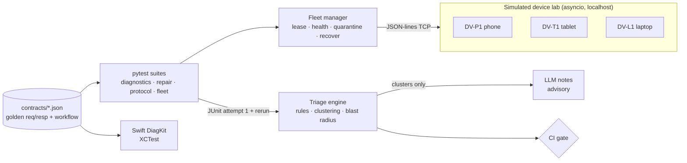

# RepairLab

Test automation for device **diagnostic and repair workflows**, run against a simulated
device lab. Python drives the lab and the test suites; a Swift package (`DiagKit`) speaks
the same protocol and is held to the same golden contracts with XCTest. CI reruns
failures, then a triage engine sorts every red test into *product bug*, *test bug*,
*lab problem*, or *flake* — with optional LLM-written root-cause notes.

```
136 pytest tests · 17 XCTest tests · 3 device families · 9-state repair workflow · 4 failure classes
```

## Why

A diagnostics team's hardest automation problem usually isn't writing one more test. It's
knowing, at 7am, whether last night's 40 red tests mean a real regression, a bad unit on
the shelf, a dropped USB hub, or a sensor that glitches one run in twenty. RepairLab is a
small, complete model of that loop:

1. a **device fleet** with leasing, health checks, quarantine, and reboot-based recovery
2. **automated suites** for on-device diagnostics and the full repair flow
   (diagnose → replace → pair → calibrate → verify → release)
3. **cross-language contract tests** so the Swift client and the device protocol can't drift
4. **CI with automatic rerun + triage**, so a flake doesn't block a merge but a real
   failure always does

## Architecture



| Path | What it is |
|---|---|
| `repairlab/device.py` | Device model: components, diagnostics with spec limits, repair mode, genuine-part checksum, fault injection |
| `repairlab/agent.py` | JSON-lines TCP agent per device; `Lab` runs a whole fleet on one background event loop |
| `repairlab/client.py` | Sync client; splits **command errors** (device said no) from **transport errors** (couldn't reach it) — triage depends on this |
| `repairlab/fleet.py` | Exclusive leasing with waiters, least-used selection, health checks, quarantine, reboot recovery |
| `repairlab/workflows.py` | Repair state machine with legal-transition enforcement |
| `repairlab/triage.py` | JUnit parsing, classification rules, signature clustering, flake detection, CI exit codes |
| `repairlab/llm.py` | Optional Claude-written notes with guardrails (see below) |
| `swift/DiagKit` | Swift protocol models, repair state machine, part authenticator, XCTest suites |
| `contracts/` | Golden fixtures both languages are tested against |

## Quick start

```bash
pip install -e ".[dev]"
pytest -q                          # 136 tests, ~5 s
repairlab fleet                    # start a lab, print fleet health
repairlab demo                     # chaos run → rerun → triage report
swift test --package-path swift/DiagKit   # macOS or Linux with Swift 5.9+
```

## The chaos demo

`repairlab demo` runs the full suite against a lab with three injected problems, reruns
only the failures, then triages both attempts:

| Injected fault | Persists on rerun? | Triage verdict |
|---|---|---|
| Degraded battery on `DVL107001` | yes (hardware) | **product**, single-device → "suspect hardware, pull the unit" |
| Link drops on `DVP107001` | yes | **infra**, 11 tests in one cluster → "check cable/power, run recovery" |
| Touch sensor glitch on `DVT107000` | no (transient) | **flaky** → "passed on rerun, track it" |

```
## 🔴 Test triage: red
103/116 passed after 2 attempt(s).

### [product] C3: test_diagnostic_passes_within_spec
- Signature: `AssertionError: <DIAG> on <DEVICE> failed: reason=OUT_OF_SPEC`
- Hits: 2 test(s) on DVL107001 (single-device)
- Next step: Suspect hardware on DVL107001: rerun on a sibling unit, then pull the device for bench diagnosis.
```

A test (`test_demo_sorts_chaos_faults_into_the_right_buckets`) runs this end to end and
asserts each fault lands in the right bucket, so the triage rules are themselves tested.

## How triage decides

1. **Flaky first:** failed on attempt *n*, passed on a later attempt → `flaky`.
2. **Rules, in order:** transport/lease errors → `infra`; `AttributeError`, missing
   fixtures, errors during setup → `test`; assertion or device command errors → `product`;
   otherwise `unknown`.
3. **Cluster** by a normalized signature (device serials, diagnostic ids, numbers, and hex
   replaced with placeholders). Infra clusters span test functions because lab problems do.
4. **Blast radius:** one device × many tests → hardware; many devices × one test →
   software regression. This decides the suggested next step.
5. **Gate:** exit `0` for green or flakes only, `1` for product/test/unknown failures,
   `2` for lab-only failures (rerun the lab, don't page the feature team).

## LLM notes, with guardrails

With `ANTHROPIC_API_KEY` set, `--ai` asks a model for root-cause notes per cluster.

* Categories are decided by rules; the model **cannot** change them.
* Only signatures and trimmed samples (≤600 chars per cluster) are sent, never full logs.
* The model must answer in JSON keyed by cluster id; ids it invents are dropped.
* Any network or parse failure returns no notes and the report still ships.

All four behaviors are covered by tests with a fake transport.

## Design decisions

* **Per-device parametrization.** Serials are deterministic, so every diagnostic runs on
  every unit as its own test case (`[DVL107001-battery.health]`). That is what makes
  blast-radius analysis possible.
* **Fresh device for mutating tests.** Repair tests get a private single-device lab, so a
  half-finished repair can never leak into the shared fleet.
* **Contracts over mocks.** The Swift side decodes the exact bytes the Python suite
  replays against the live agent. A protocol change breaks one side of CI immediately.
* **Faults model real failure physics.** Reboot clears transient faults (hangs,
  glitches) but not hardware degradation; a link that drops can't be rebooted remotely.

## Lab runbook

See [docs/RUNBOOK.md](docs/RUNBOOK.md) for triaging a red nightly and handling a
quarantined device.

## Limits

The devices are simulated; there is no XCUITest or physical robot here. The parts of the
work that transfer directly are the fleet logic, the test architecture, the CI rerun and
gating policy, and the triage rules.
